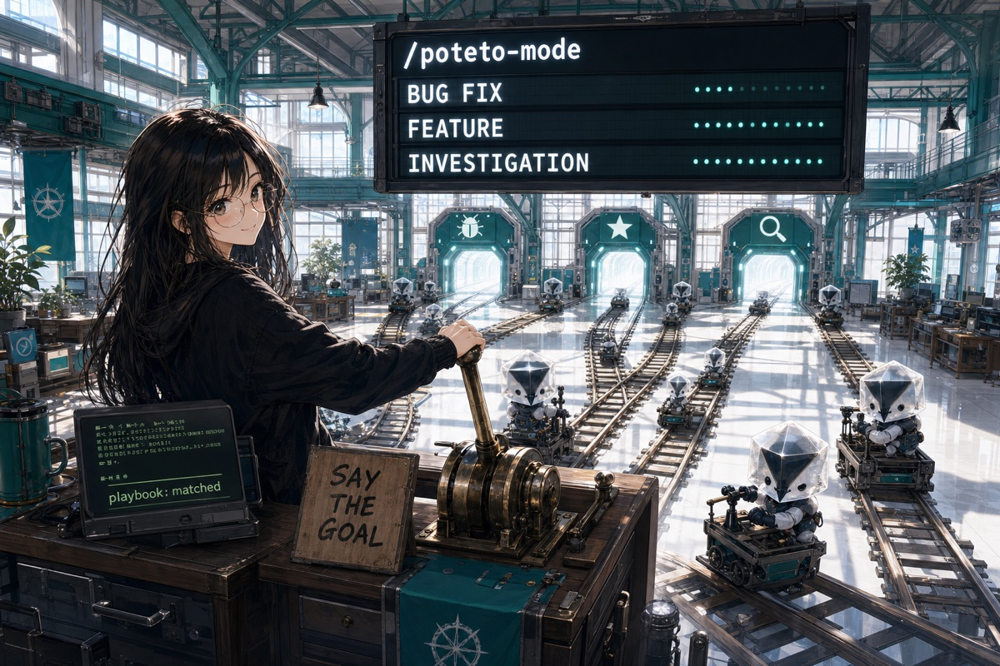
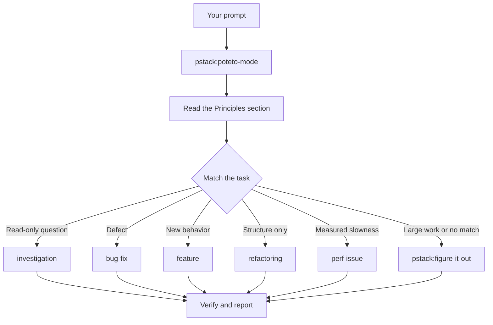

# Route work through `pstack:poteto-mode`

`pstack:poteto-mode` is the front door. You give it a goal. It matches one of 22 routed playbooks, copies the playbook steps into `todo`, and loads other qualified skills when their steps begin. This page shows what a useful prompt contains and why it can stay short.



## What happens to your prompt



The complete route catalog is part of parity, not a shortened menu. The 22 routed playbooks are `authoring-a-skill`, `autonomous-run`, `autopilot-full`, `autopilot-stack`, `babysit`, `bug-fix`, `eval`, `feature`, `hillclimb`, `investigation`, `multi-phase-plan`, `orchestrate`, `pause-safely`, `perf-issue`, `prototype`, `refactoring`, `runtime-forensics`, `session-pickup`, `shipping`, `trace-forensics`, `visual-parity`, and `worktree-cleanup`. `opening-a-pr` is the shared postlude, not a route. Read the [playbook directory](../../packages/pstack/skills/poteto-mode/playbooks/) for each full procedure.

Poteto uses `delegate_task` for bounded fan-out. It can use `delegate_with_route` only when an installed and approved runtime companion has validated that route alias. Missing runtime support degrades to built-in tools; it does not block the playbook.

## Say the goal, not the ceremony

State what is wrong and add any fact that saves investigation time:

```text
skill_view("pstack:poteto-mode")
Goal: users get two notifications after a retry.
Constraint: reproduce the duplicate first.
Evidence: show the failing and corrected retry output.
```

That prompt matches `bug-fix`. The reproduction is a constraint, not politeness. A skipped playbook step remains in `todo` with `skip: <reason>`.

When the conversation already holds the context, the instruction can shrink:

```text
Do it using the active playbook.
```

```text
Continue the active Poteto task.
```

```text
Keep going until the stated finish condition passes.
```

Short prompts work because the active playbook holds the procedure. The prompt still needs a recoverable goal and a check somewhere in the conversation.

## Switch tasks with "new task"

A long chat accumulates assumptions from the last task. Mark the boundary:

```text
skill_view("pstack:poteto-mode")
New task: find why the cache entry survives logout. Do not change code yet.
```

`new task` makes Poteto match again. The no-edit constraint pins this request to `investigation`. Without the boundary, a mode already inside `feature` can misread the question as the next feature step.

## Give parallel work its own worktree

Several delegates must not write to one working tree. Ask for isolation before fan-out:

```text
New task: branch from <base> in a fresh worktree, then port the parser change there.
```

Use one worktree per write-capable delegate. The [`opening-a-pr` postlude](../../packages/pstack/skills/poteto-mode/playbooks/opening-a-pr.md) also expects isolated code work. Creating a commit, pushing a branch, or opening a PR still requires explicit current authorization.

Worktrees accumulate. Ask Poteto to inspect them with [`worktree-cleanup`](../../packages/pstack/skills/poteto-mode/playbooks/worktree-cleanup.md). It can classify merge state, uncommitted work, and known session ownership. It must use `clarify` before any deletion unless the operator's current instruction explicitly authorized the exact cleanup target.

```text
Use worktree-cleanup to report what is consuming disk. Do not delete anything until I approve the exact targets.
```

## Leave it running

When you step away, define done and the stop condition:

```text
Keep working in this session until the migration check reports zero old callers.
Keep a local decision log. Stop and report if progress stalls.
Do not commit, push, message, deploy, delete, or change a live profile.
```

Work reviewed later routes through [`pstack:figure-it-out`](../../packages/pstack/skills/figure-it-out/SKILL.md), which designs the phases, and [`pstack:show-me-your-work`](../../packages/pstack/skills/show-me-your-work/SKILL.md), which keeps the decision log. [Run work while you sleep](./07-overnight.md) gives the full contract.

Hermes delegation is bounded by the owning conversation and is not restart-durable. If the work must survive that lifecycle, use `cronjob` only after explicit current authorization for the schedule, prompt, working directory, and any delivery. The optional runtime companion may preserve route state and health, but it does not turn an in-flight delegate into a durable job.

**Pitfall:** do not enumerate a hand-written skill sequence. The playbook already orders the work. Name a qualified skill only when you want to override one choice.

Read [`pstack:poteto-mode`](../../packages/pstack/skills/poteto-mode/SKILL.md) for the full routing rules.

Next: [Understand the code](./03-understand.md).
