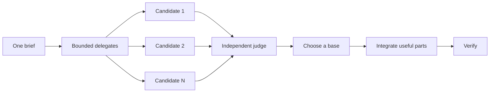

# Design before you write code

One attempt at a hard design locks in the first plausible shape. `pstack:architect` settles types and boundaries before implementation. `pstack:arena` compares several attempts at one brief and synthesizes a result. `pstack:interrogate` tries to break that result. When the job needs coverage rather than synthesis, `pstack:swarm` partitions independent slices or declared race arms.


## Settle the shape with `pstack:architect`

```text
skill_view("pstack:architect")
Design the import pipeline before writing code. Start with how callers use it.
```

[`pstack:architect`](../../packages/pstack/skills/architect/SKILL.md) first loads `pstack:how` over the touched code and `pstack:why` when the design moves ownership or layers. It then loads `pstack:arena` for competing sketches. Each sketch puts caller usage first, followed by types, signatures, and a module map.

The workflow can proceed from the synthesized design into local implementation when that work is already within scope. Ask for a checkpoint when the design choice needs the operator:

```text
skill_view("pstack:architect")
Use a checkpoint. Show the synthesized design before implementation.
```

At the checkpoint, Hermes uses `clarify`. It does not treat silence as approval for a consequential design choice.

## Fan out attempts with `pstack:arena`

```text
skill_view("pstack:arena")
Use this prompt verbatim. Compare the candidates with the current approach.
```

[`pstack:arena`](../../packages/pstack/skills/arena/SKILL.md) sends the same brief to multiple delegates with `delegate_task`. Give every write-capable candidate a separate worktree or output directory. An approved `delegate_with_route` alias may select a validated role. Without that alias, built-in delegation is enough.

The optional runtime companion can hold role preferences and health results. It cannot promise model-family diversity, hard read-only children, or cloud isolation unless the current runtime proves those features. The coordinator reads each candidate, scores the stated rubric, chooses a base, integrates useful ideas from the other attempts, and verifies the synthesis.



Load [`pstack:setup-pstack`](../../packages/pstack/skills/setup-pstack/SKILL.md) to inspect validated role settings. Ask for more candidates when reversal is expensive and fewer when it is not:

```text
Use pstack:arena with five candidates. The cache-key format is expensive to change later.
```

## Cover slices and races with `pstack:swarm`

```text
skill_view("pstack:swarm")
Check every package under packages against its check script. Use one worker per package and return one report.
```

[`pstack:swarm`](../../packages/pstack/skills/swarm/SKILL.md) assigns independent slices, coverage cells, gauntlet lanes, exploration partitions, or declared race arms through `delegate_task`. Each worker gets one scope and one check, then reports `PASS`, `ISSUES`, or `BLOCKED`. The parent waits for every slice and returns a compact report with gaps and dropouts.

Use `pstack:arena` when every candidate receives the same brief and a coordinator must synthesize a base. Use `pstack:swarm` when the work partitions cleanly or when a race has a selection rule stated before dispatch.

## Break it with `pstack:interrogate`

```text
skill_view("pstack:interrogate")
Review the whole branch skeptically. Do not edit. Ignore style nits unless they expose a defect or regression.
```

[`pstack:interrogate`](../../packages/pstack/skills/interrogate/SKILL.md) sends the same diff, intent, and rubric to several delegates. The lead sorts findings into `Act on`, `Consider`, `Noted`, and `Dismissed`, and gives a reason for every dismissal. It does not apply a finding automatically. Any edit must stay within the current task authority; an external action still needs separate authorization.

Read the dismissals. The lead is a reviewer, not an oracle, and you can override its judgment.

## How much design work does a task deserve?

Most changes do not need the full panel. Use this ladder:

- A small finished change you distrust needs `pstack:interrogate` alone.
- A change that crosses function boundaries or moves ownership earns `pstack:architect`, which invokes `pstack:arena`.
- A standalone decision that benefits from independent attempts uses `pstack:arena` directly.
- A coverage matrix, parallel check set, or declared race uses `pstack:swarm`.
- A contested design that is expensive to reverse uses `pstack:architect`, followed by `pstack:interrogate` before delivery.

`pstack:poteto-mode` applies this ladder. Load these skills directly only when you want more or less scrutiny than the matched playbook supplies.

Next: [Build and clean the change](./05-build-and-clean.md).
