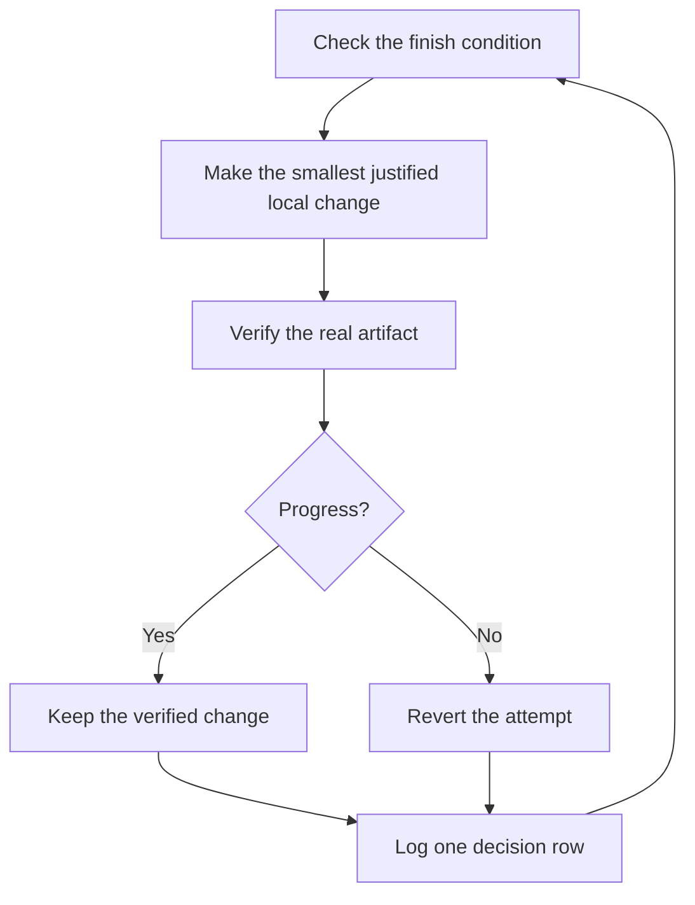

# Run work while you sleep

Long unattended work is safe only when it has a checkable finish condition, isolated files, a decision log, and a bounded authority statement. Hermes also needs an honest lifecycle. A child started with `delegate_task` does not survive the owner process disappearing.


## The overnight contract

A useful handoff states the goal, checks, permissions, and stop condition:

```text
skill_view("pstack:poteto-mode")
Goal: migrate every caller to the new parser in a fresh worktree from <base>.
Done: zero old callers, all parser fixtures pass, and the old API is removed.
Authority: local edits and verification only. Do not commit, push, message, merge, deploy, delete, or change a live profile.
Audit: keep a local decision log. If progress stalls, stop and explain the blocker.
Lifecycle: continue only while this owning session remains alive.
```

Each line has one job:

- The goal identifies the output.
- `Done` gives every iteration checks that can pass or fail.
- The worktree keeps write-capable delegates away from other work.
- `Authority` prevents the task from expanding while the operator is absent.
- The audit line leaves evidence and an escape hatch.
- The lifecycle line avoids a false durability promise.

[`pstack:figure-it-out`](../../packages/pstack/skills/figure-it-out/SKILL.md) designs the phases. The preserved [`poteto-agent` prompt](../../packages/pstack-runtime/resources/agents/poteto-agent.md) can supply an optional role brief. Built-in `delegate_task` remains available without `pstack-runtime`.

For a run that must survive the conversation lifecycle, create a `cronjob` only after explicit current authorization for its schedule, prompt, work directory, allowed actions, stop rule, and delivery target. A schedule does not inherit permission to commit, push, message, merge, deploy, or expose a service.

## What the loop does all night



One change, one check, and one log row make an iteration. An attempt that does not help is reverted rather than carried forward. A plateau triggers a new hypothesis or a blocked report. The finish condition never weakens to make the run look successful.

Local reverts and deletion are not interchangeable. Removing an exact failed change created by the current run can be part of recovery. Deleting pre-existing work, a worktree, or stored evidence requires explicit current authorization.

## The morning audit

[`pstack:show-me-your-work`](../../packages/pstack/skills/show-me-your-work/SKILL.md) records time, phase, decision, reason, evidence pointer, and result in a local TSV. The usual names are `decisions.tsv` or `.audit/<task-slug>.tsv` when several runs share a directory. Keeping the file local needs no external action. Committing it requires current authorization.

Ask for review form when you return:

```text
skill_view("pstack:show-me-your-work")
Summarize the last run from its decision log and session history. Put items that need my judgment first.
```

The skill can use `session_search` and a fresh `delegate_task` reviewer to challenge the trail. Read the Attention section first, then inspect the cited log rows. You are auditing decisions rather than replaying every token.

## When the night holds a queue, not a task

The same contract scales to a queue, but the route names do not widen authority.

[`autopilot-full`](../../packages/pstack/skills/poteto-mode/playbooks/autopilot-full.md) preserves the upstream queue procedure. In this isolated candidate it can build and verify independent items, but it stops before commits, pushes, PR creation, merges, messages, or deployment unless each external action has explicit current authorization. The name `autopilot-full` is not standing merge permission.

```text
skill_view("pstack:poteto-mode")
Use autopilot-full on this independent queue. Prepare and verify local results only. Stop before every external action.
```

[`autopilot-stack`](../../packages/pstack/skills/poteto-mode/playbooks/autopilot-stack.md) preserves ordering for coupled changes and returns verification for each link. It does not create or land a remote stack without separate authority:

```text
skill_view("pstack:poteto-mode")
Use autopilot-stack for these five coupled changes. Keep the result local and return the proposed order and evidence.
```

[`orchestrate`](../../packages/pstack/skills/poteto-mode/playbooks/orchestrate.md) handles a program that spans many bounded briefs. The coordinator delegates, collects receipts, and keeps the plan current; it does not write code under the preserved role contract. Use `todo` for the active plan. Use an authorized durable system for work that must outlive the session:

```text
skill_view("pstack:poteto-mode")
Use orchestrate for the store migration. Keep all work local, verify each package, and stop at every authority boundary.
```

`pstack-benny` is a separate dormant plane. It preserves `setup-benny`, `triage-issue-reports`, and `reproduce-and-fix-issues` with their templates and references. It is not a scheduler or a default skill set. Enabling an event source, credentials, external messages, issue updates, or delivery needs separate authorization and fake-first proof.

**Pitfall:** a duration is not a finish condition. "Work for four hours" gives the agent no result to check. State a predicate that can pass or fail, and state what the run must do when it cannot pass.

Next: [Steer with principle names](./08-principles.md).
